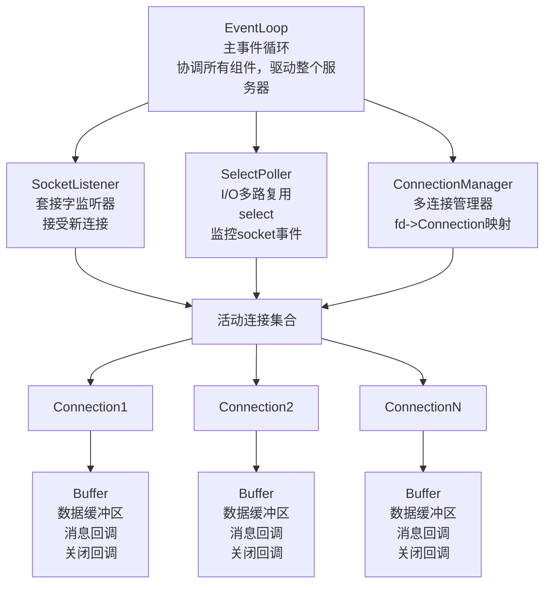

# C++演进式网络库

## 📖 项目概述

一个通过 **阶段性演进式实现** 以**数据驱动**的网络库学习项目，旨在深入掌握C++网络编程、内存管理与并发优化的核心原理。

### 🎯 核心学习理念
- **自主思考**：个人实现，**非网课/培训项目**，真实性会尽量及时更新有决策日志，压测报告，性能报告，架构图，以及多项commit message多为详细的Issue-Change-Result结构
- **踩坑演进**：从最简单的阻塞IO开始，逐步演进到select、epoll、io_uring，每一步都亲身体会“为什么要有下一步”, 并记录性能提升的过程
- **数据驱动**：每个阶段都有明确具体真实的性能指标对比和问题发现。**工具链**：wrk、top、perf、Valgrind、strace等
- **深度优先**：拒绝黑盒调用，直面底层原理，并产出博客记录
- **架构演进**：项目遵循从0演进架构，不进行过早优化，让架构自然在问题中长出来

### 📝 我的博客
https://mp.weixin.qq.com/s/Kn-uA6J0l83c6KVfErxMQQ

### 📆 阶段性规划

**Week 1: 跑通一个阻塞IO模型的echo服务器**✅

**核心实现与成果**
- 实现单线程阻塞IO模型echo服务器

**阶段成果**
- 博客：第一篇技术博客《从阻塞开始：accept()和recv()阻塞的本质及唤醒机制》

**当前阶段痛点**
- 只能支持一个连接，第二个连接阻塞

**Week 2: select引入，从服务器到网络库的多步重构**✅

**核心实现摘要**
- 从阻塞IO重构为select多路复用模型，支持多客户端并发连接
- 事件循环增加超时机制，防止少数连接阻塞整体处理
- 创建Buffer类，为解决调度不均，做字节切割，并为后续每连接独立缓冲区奠定基础
- 创建SocketListener类，替换Socket类
- 引入Connection类与ConnectionManager，实现每个连接独立缓冲区，解决P99延迟剧烈波动问题
- 将阻塞IO逻辑封装至SelectPoller，方便后续替换IO模型
- 创建EventLoop类，并且彻底删除TCPServer这个上帝类，将功能安排在各个组件，并将第一阶段的三大函数拆分成了多个小方法，降低耦合度
- 实现多处函数指针回调，解耦网络层与业务逻辑

**性能排查**(过程记录于博客)
- 在将环境从本地回环切换至用宿主机压测容器的服务时，QPS从8500暴跌→400，经排查锁定tcp_tw_reuse参数，修复后性能恢复且上升至11000

- 经测试发现P99随机严重崩塌至1000ms，经排查锁定调度不均+共享缓冲区资源竞争问题，经架构演进（添加Buffer类于Connection类）后P99稳定至10-13ms

- 1w QPS 远无法达到select瓶颈，经排查锁定TIME-WAIT短连接风暴，将HTTP响应改为长连接，QPS 1w → 8.5w

**三个感悟**
1. 认清这不是高性能echo server，而是网络框架。业务逻辑与网络层必须解耦，否则后续所有优化都是耦合的
2. 不能依赖单轮数据做判断，不要同时做多个改动并且不测试，容易导致归因错误
3. 不断拆除TCPServer上帝类来逼近清晰的架构，保证这是一个组件式工具箱而不是一个黑盒

**阶段成果**
- 并发连接数： echo: 1连接 → select: 支持 1024 长连接, 1800 短连接
- P99延迟：100并发下 3.95ms 200 并发下 5.11ms 400并发下 10.95ms 600并发崩塌至1000ms（与epoll阶段症状相同，修复中）
- **QPS：echo: 1 连接下 本地回环8.5k → 100并发下 8.5w 1000并发下 7.3w 1200 并发下崩塌至 3.4w**

- 架构：实现组件、连接层、业务层三者与网络层的解耦，并初步划分职责
- 博客：
《拷贝构造函数：为什么非要&引用？传值和传指针会怎样》
《连续两次QPS暴跌95%：面经纠错+第一次性能排查连踩七个坑？》
《缓冲区共享导致的P99剧烈抖动——为什么一定要有Buffer和Connection类》

**当前阶段困难**
- Select文件描述符1024瓶颈对长连接的限制

**Week 3: IO模型升级**🚧
- select → epoll ET模式（核心替换）
- 可能会遇到EAGAIN和边缘触发
- 性能对比：延迟降低？%，CPU降低？%，连接数上升？%，QPS变化？%
- 产出：《epoll ET模式实战与踩坑记录》

**Week 4: 规模性性能分析**（以下均为未实现规划💭）
- 建立自动化压测框架
- docker部署
- 产出：完整的性能基准测试

**Week 5: IO模型再次升级**
- epoll → io_uring
- docker部署
- 产出：完整的性能基准测试

**Week 6: 内存优化探索**
- 引入Message对象池（第一个优化点）
- Valgrind分析：malloc调用减少？%
- 可能会遇到伪共享导致性能回退
- cache line对齐（alignas 64）
- 可能会遇到伪共享导致性能回退
- cache line对齐（alignas 64）
- 产出：内存优化专项报告

**Week 7: 协议层强化**
- 实现零拷贝转发原型
- 引用计数缓冲区设计
- 性能对比：大消息场景CPU降低？%
- 产出：零拷贝技术验证报告

**Week 8: 架构设计准备**
- 分析单线程瓶颈（CPU跑满）
- 产出：多线程架构设计方案，在遇到瓶颈后再升级无锁队列
- 产出：多线程架构设计方案，在遇到瓶颈后再升级无锁队列

### 最终对照数据（Week 3与week 8）
- 最大连接数：？ → ？（？倍）
- P99延迟：？ms → ？ms（降低？%）
- CPU使用率：？% → ？%（降低？%）
- malloc调用：？次/秒 → ？次/秒（减少？%）

### 架构说明

           
核心组件：
| 层级 | 职责 |
|------|------|
| 网络层 | 事件驱动的核心，负责监听事件、分发 IO |
| 连接层 | 管理连接、数据收发 |
| 缓冲区组件层 | 处理数据的拆包 |
| 业务层 | 用户注册业务回调（图中的TCP/HTTP响应仅为示例用，可忽略） |

### ⚒️工具说明

| 组件 | 版本 |
|------|---------|
| Ubuntu | 24.04 |
| Linux内核 | 6.6.87.2 |
| Docker | 29.2.1 |
| WSL2 | 6.6.87.2 |
| CMake | 3.28.3 |
| GCC | 13.3.0 |

