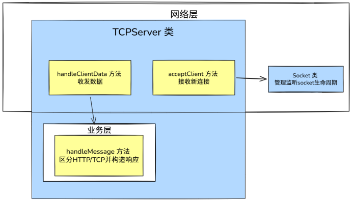
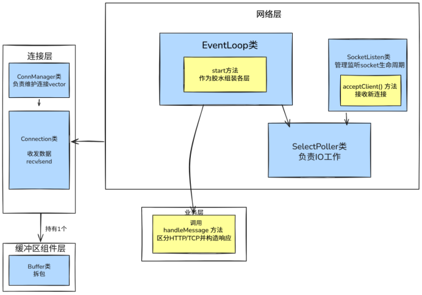
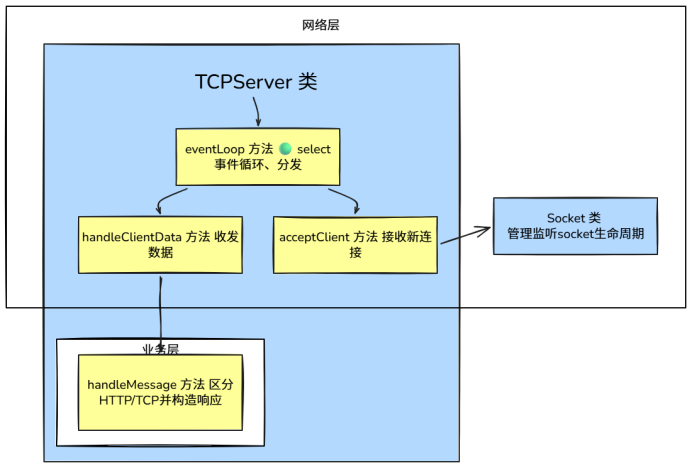
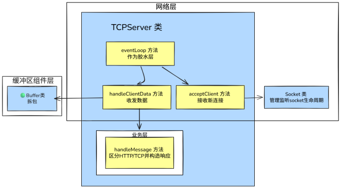
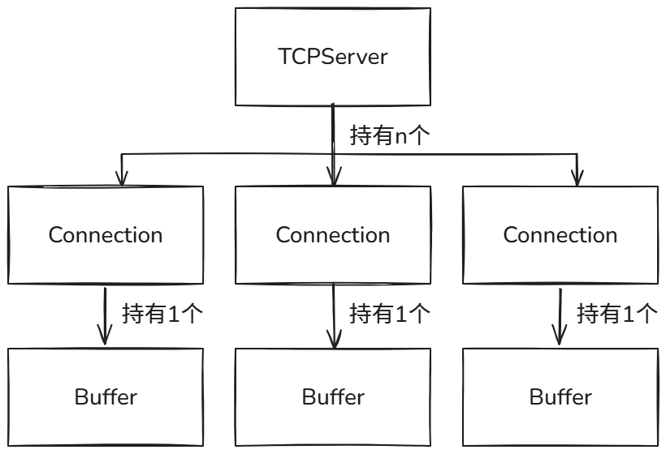
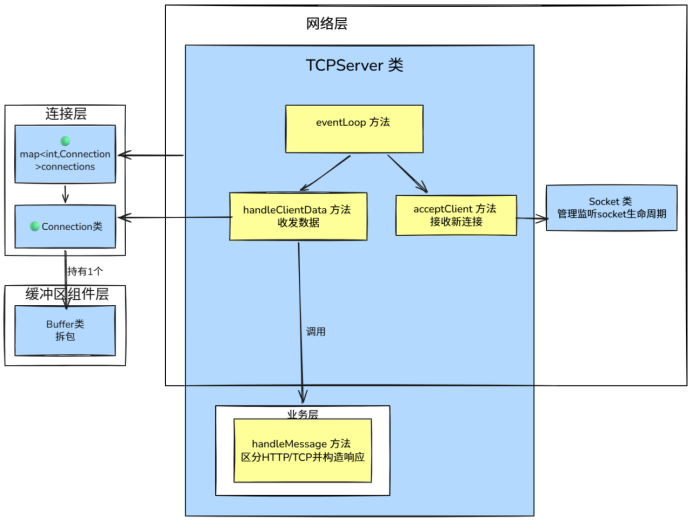
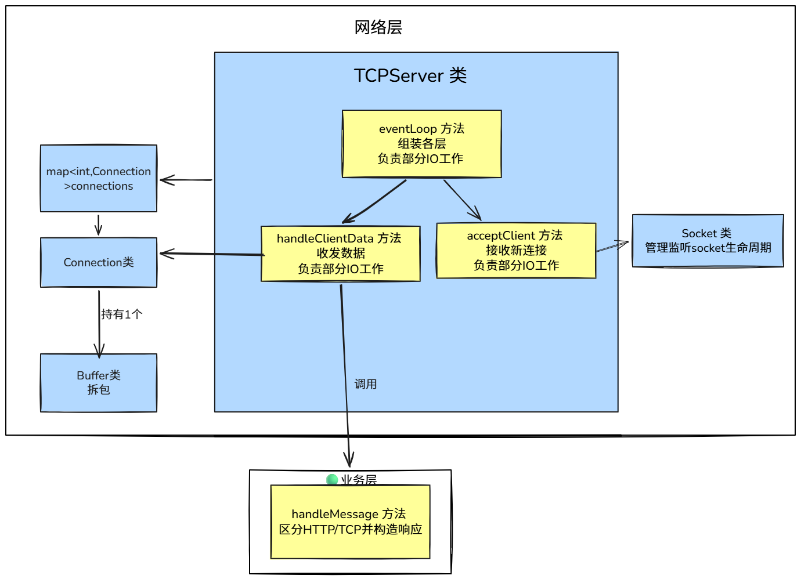
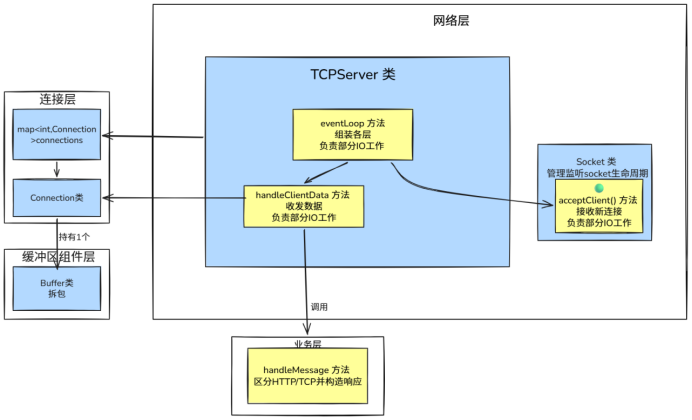
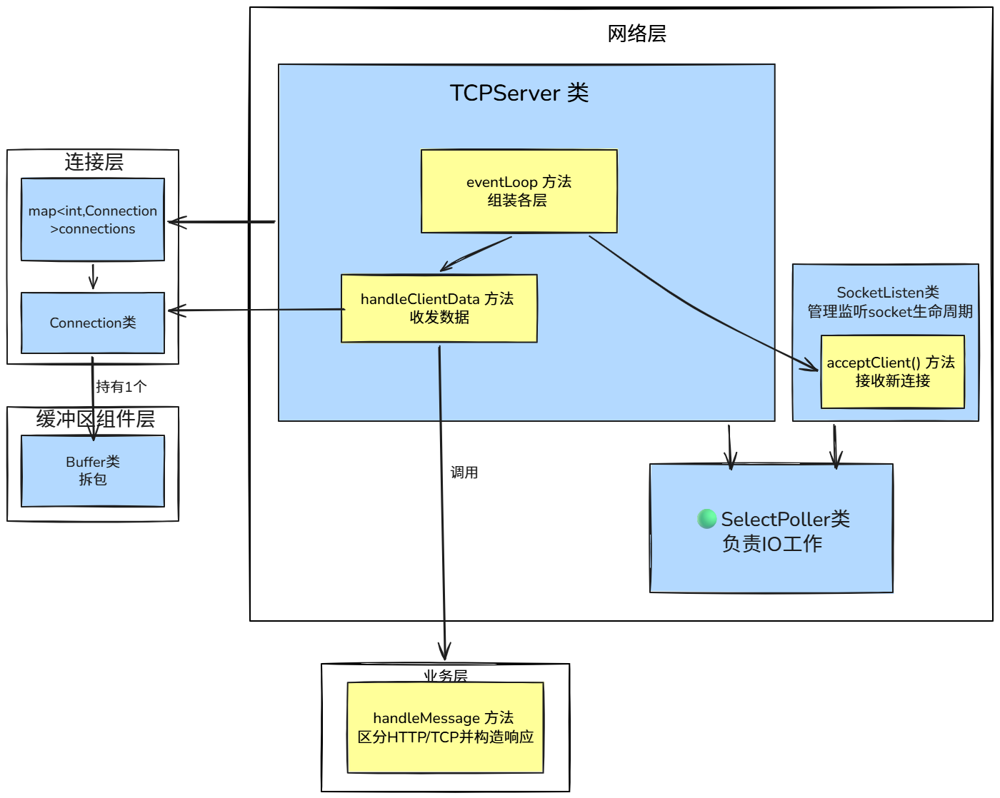
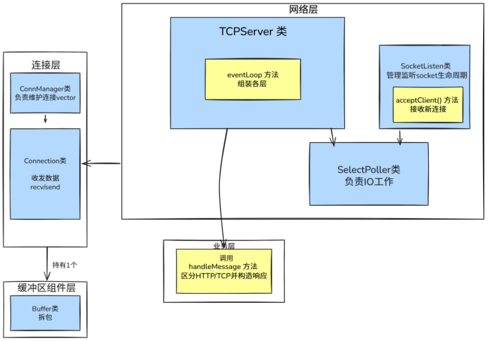

## Select阶段架构演进说明
本篇文章会呈现我在select阶段的逐步重构，通过九轮更改为一个阻塞IO的服务器逐步创建组件、解耦组件、削减职责，始终保持以**问题驱动**去变更架构, 同时会带来一些**select实际运用中的困难、以及libevent源码片段的解读**
### 初始架构图

### 阶段最终架构图


### 演进摘要

关键词就三个: **创建 解耦 削减职责**

| Commit Hash| 改动 | 效果 |
|--------|------|------|
| c88aff | 创建 Buffer 类 | 创建第一个组件层模块 |
| 230cd0 | 实现 Connection 类 | 创建连接层的概念，区分每个连接 |
| f97e54 | 实现函数指针回调 | 解耦业务层与网络层 |
| 6cfdc7 | 从 Socket 中抽取 SocketListener⭐ | 将绑定监听建立连接作为一个模块，**决定开始削减TCPServer的职责**（本次为建立连接） |
| b69ee2 | 创建 SelectPoller⭐ | 解耦IO模型与网络层，进一步削减TCPServer的职责，**但遇到封装矛盾**（IO相关工作） |
| d95fdc | 创建 ConnectionManager 类 | 解耦连接层与网络层，进一步削减 TCPServer 职责，（管理连接） |
| d8f03b | 移除职责过重的 handleClientData() | 解耦连接层与网络层，进一步削减 TCPServer 职责（数据收发） |
| 74f31f | 创建 EventLoop 类 | 移除 TCPServer 类 |
|        | **EventLoop变成新的上帝类了(持有所有组件)** | **许多新问题待重构...** |
### 具体演进过程

#### 1. 从阻塞 I/O 重构为 select 多路复用模型，事件循环抽象为 eventLoop()

select 模型要求我们在每次循环前维护三样东西：

| 变量 | 作用 | 维护时机 |
|------|------|----------|
| `all_fds` | 永久存储所有要监听的 fd | 增删连接时修改 |
| `read_fds` | 每次 select 前从 `all_fds` 拷贝的副本 | 每轮循环重新拷贝 |
| `max_fd` | `all_fds` 中的最大 fd 值，select 需要用它优化扫描 | 增删连接时可能更新 |

这三者的初始化、拷贝、更新、删除操作贯穿了数据流动的整个过程。

##### 1.1 问题

当我把阻塞IO替换为select模型时，我试着把select相关的工作分散给acceptClient()与handleClient。

于是把**添加fd**的工作给了acceptClient() ，每次 accept 成功时 FD_SET(new_fd, &all_fds)、更新 max_fd

因为handleClient内含错误处理后移除连接的逻辑，所以**移除fd**的工作交给它，连接关闭时 FD_CLR(fd, &all_fds)、以及可能需要重新计算 max_fd的逻辑

但是做完了这些之后，我发现还有许多无法塞入，每次事件循环启动前都需要**初始化 fd_set 的状态**，调用select前需要**拷贝fd的副本**（因为select模型会直接修改fd集合），select返回后还需要**检查就绪状态**，这些都无法简单封装在这两个函数里。

##### 1.2 实现
于是我重构了start(), 将IO模型的工作，与就绪状态的检查放入，并承担原先调用acceptClient和handleClient的职责，改名为更合适的名字eventLoop。

##### 1.3 结果
图中可以看出，虽然实现了事件循环，不过从根本上来说，整个流程绝大部分都是TCPServer在负责（主要是其中的两大函数），调用链非常简单，就是事件循环，检查fd的就绪状态，若listen_fd就绪则调用acceptClient()，若client_fd就绪则调用handleClient()，业务逻辑写死在TCPServer里，等待被handleClient去调用。**作为一个echo/HTTP响应器来说是好的，作为一个网络框架来说是糟糕的。**

（绿点标注的地方为更新处，之后的图像也是。）


#### 2. 创建 Buffer 类并封装相关方法

##### 2.1 问题

创建缓冲区进行粘包处理，不是因为我感觉到我缺了一个组件，而是因为我开始关注P99问题，仅100并发时，P50-P90稳定在15ms内，但P99随机出现剧烈波动，最高崩塌至1000ms，明显是**调度不均**。

我想要去限制每一次处理的请求量，但是怎么限制请求量，我并不知道，我只知道TCP是流式传输，目前根本没有“一个请求”的概念，因为所有请求都没有边界地连在一起。所以先**找边界**

怎么找？或许可以先用string做缓冲区，find()函数实现查找。

在哪里找？在数据从内核到用户态程序的进口，也就是缓冲区。

我此时的缓冲区是用char*[]实现的一个buffer，固定编码1024字节，不是不够用，而是无法去添加方法，又不能把所有东西都写在handleClient，所以我应该创建一个buffer类专门去盛放这些方法。

##### 2.2 实现
先进行限制每次处理的请求量，实现如下：

在Socket类中增加新成员对象：string类型的recv_buffer，以及
对应的get函数

将原来的buffer改为char[]类型的temp_buffer，作为函数内接收
数据的临时缓冲区

将temp_buffer中的数据追加到recv_buffer，**切分多余请求、拼接
不完整请求，每轮迭代只处理n个请求**

此后P99依然无改善，随机崩塌。虽然Socket类内部实现了基于string的buffer，但本质上还是一个所有连接共享的buffer。要改为每个连接独立的buffer，需要**先创建Buffer类以及连接相关类。**

创建buffer类后，将recv_buffer作为了Buffer类的成员函数，并且将数据追加、数据切分封装为Buffer类方法，分别为appendData()、takeData()

##### 2.3 结果
- 这样就**分离Socket类和Buffer类职责**，为创建连接相关类、实现每个连接独立buffer奠定了基础。
- 有了该网络库的第一个组件，缓冲区。
接下来就理所应当创建Connection的概念



#### 3. 实现基础 Connection 类与三层分层设计

这里说的三层分层设计指的是TCPServer->Connection->Buffer



##### 3.1 问题
实现Buffer类后，P99延迟仍然在10ms到1000ms之间剧烈波动。20次连续间歇性测试中，仅有3次P99恢复至11ms左右，其余仍在1000ms左右。Buffer类还是作为TCPServer单例实现，所有连接共享同一个buffer，多个连接的数据混合在一起。
    
##### 3.2 实现
1. 创建Connection类，提供默认构造函数用于map索引，提供参数化构造函数用于初始化client_fd
2. 创建`map<int, Connection> connections`，建立client_fd与Connection的一一映射，**该map由上层的TCPServer持有**
3. 修改Buffer类成员函数的调用链，`recv_buffer.append()`→`connections[client_fd].recv_buffer.append()`

##### 3.3 结果
P99降至10ms-13ms，稳定性大幅提升
在架构层面，我们将连接层从网络层剥离了出来，形成TCPServer->TCPServer->Connection->Buffer的分层



#### 4. 实现函数指针回调，解耦业务逻辑与网络库

##### 4.1 问题

从上面的图其实都可以看出，业务逻辑（区分HTTP/TCP并构造响应）被硬编码在了TCPServer类中，业务层与网络层耦合，我也意识到了我如果一直做下去，这最多是一个服务器，并不会做着做着自动变成网络框架/网络库，因为从用户视角看，无法添加业务逻辑，只能调用eventLoop启动服务。

##### 4.2 实现

这里采用了回调指针去实现回调函数，当时我认为在流量网关等场景中，选择函数指针而非`std::function+lambda`，可以牺牲更高的灵活性换取更低的性能开销, 定义回调类型：`MessageCallback = std::string(*)(const char*, ssize_t)`, 并且添加对应的函数去储存用户提供的业务逻辑

##### 4.3 结果

- 将业务层从网络层剥离了出来，减轻了TCPServer的职责



#### 5. 从 Socket 中抽取 SocketListener, 封装accept系统调用

##### 5.1 问题⭐
现在来稍微理一下每一层的职责，会发现TCPServer的职责仍然过重

| 层级 | 类 | 职责 |
|------|-----|------|
| 网络层 | TCPServer | 事件循环、**fd_set维护、建立连接、数据收发、维护连接map** |
| 网络层 | Socket | 绑定、监听、socket套接字生命周期 |
| 连接层 | Connection | 维护一个缓冲区（持有 Buffer） |
| 组件层 | Buffer | 处理拆包、粘包 |

整整五件事情，都由TCPServer来负责。
职责过重会导致难以修改，难以复用，比如我现在要想换一个IO模型，从select换到epoll，我需要修改eventLoop()、acceptClient()、handleClient(), 几乎贯穿整个流程

所以决定**以删除TCPServer为目标，逐步减轻TCPServer的职责，最终的目标是使得下层的组件即使没有上层也可以通过调用组装在一起，上层仅作为胶水层组合下层，下层没有上层也可以运行**

##### 5.2 实现

我们先把acceptClient()挪至Socket类，因为`bind()、listen()、accept()`都是为了一件事情，**把一个socket变成能接收监听的socket**。

于是这里还更改了名字，
`Socket`->`SocketListen`
`acceptClient()`->`accept()`

##### 5.3 结果

- TCPServer进一步减轻不属于它的职责，现在它不需要建立连接了
- 把`bind()、listen()、accept()`放在一个类里面，更符合直觉与标准实践



#### 6. 创建SelectPoller类，将 IO 模型与系统调用解耦，为替换 epoll 做准备

##### 6.1 问题

上一条里面提到了，如果想要换IO模型，要改三个函数，而这三个函数几乎占70%的总代码，所以这里就不多说了，直接进行修改。

这里的名字其实起的不好（后期已修改为Poller），叫做select会暴露底层细节实现。

##### 6.2 实现

- 封装select相关的fd_set管理和wait()逻辑作为`SelectPoller`的方法
- 将检查就绪状态的逻辑封装为`isReady(int fd)`
- `TCPServer::eventLoop()`中的select逻辑(初始化、检查就绪)迁移到`SelectPoller::wait()`

##### 6.3 矛盾

但这里其实有个矛盾，我在实现 `TCPServer::eventLoop` 时，需要遍历所有活跃的 fd，逐个检查是否就绪：
```cpp
for (int fd : poller.client_fds) {      // ← 被迫公开 client_fds
    if (poller.isReady(fd)) {
        handleClientData(fd);
    }
}
```
1. 为什么会有这样的问题：

这里涉及到select的缺陷，它本质上返回的是修改过的fd_set位图，而**无法像epoll那样返回就绪的fd列表**，要想获得就绪的fd列表，还需要**开发者自己去遍历**，然后把就绪的fd加入到自己维护的`client_fds`列表里

2. 为什么这时候才遇到这个问题：

因为之前client_fds由TCPServer维护（目前也是），而IO相关的工作，**对client_fds列表进行遍历、增删这些之前都由TCPServer负责**，现在这些工作从TCPServer剥离出去了，自然遇到这个问题。

3. 一定要公开client_fds吗？没有更好的实践吗？

有的，libevent有一个模块也使用select, 但没有像这样暴露资源

我们可以通过阅读源码简单过一遍libevent的流程，这一遍我删了很多内容，只重点关注遍历、维护、读写调用（完整版在文章末尾）。在event.c的1990行，是event_base_loop()

```c
int
event_base_loop(struct event_base *base, int flags)
{
	// 结构体、变量声明、加锁、以及时间轮和标志检查处理等逻辑
	
	while (!done) {

		// 检查标志与设置时间等逻辑

		// 调用用户注册的prepare机制

		// 核心！在事件循环这里仅调用dispatch()把事件分发处理，
		// 而非在这里进行遍历、读写，也不会在这里调用读写系统调用
		res = evsel->dispatch(base, tv_p);

		if (res == -1) {
			// dispatch报错与错误处理
			}

		// 调用用户注册的check机制


		// 根据是否为非阻塞和有无事件决定是否退出循环
	}
	// 退出while循环后重置时间、标志、释放锁

}
```

所以libevent并没有在主循环里面遍历、也没有调用读写函数，而是把这些封装进了dispatch()，自然也没有出现暴露资源的情况，libevent出于跨平台兼容，会根据优先级尝试哪个IO后端可用，我们再来看一下当后端为select时，select_dispatch()的代码, 在select.c的140行

```c
static int
select_dispatch(struct event_base *base, struct timeval *tv)
{
	// 声明结构体、变量

	// 扩容机制

	// 之前提到过select不会返回就绪队列，而是直接修改传进去的fd_set，所以需要一个临时集合作为副本
	// 把in读写集合（永久集合）拷贝给out读写集合（临时集合）

	// 注意：这里给nfds赋值，event_fds就是max_fd+1，也就是遍历要用到的整数
	nfds = sop->event_fds+1;

	// 调用前释放锁

	// 调用select，接收返回值
	res = select(nfds, sop->event_readset_out,
	    sop->event_writeset_out, NULL, tv);

	// 调用后加锁

	// select 错误处理

	// 调试用

	// i是随机数，因为fd有大小顺序，若每次遍历从初始值开始则会导致调度不公平，
	// libevent选择每次从不超过max值的随机值开始遍历，并为了跨平台兼容自己实现了随机值函数
	i = evutil_weakrand_range_(&base->weakrand_seed, nfds);

	// 重点！这里去遍历fd，直到max_fd
	for (j = 0; j < nfds; ++j) {
		if (++i >= nfds)
			i = 0;    // 保证每一轮随机值+1，从不同位置开始
		res = 0;    // 一轮刚好遍历 0~max_fd 各一次。

		// 遍历过程遇到可读的fd，分别进行可读、可写的标记
		if (FD_ISSET(i, sop->event_readset_out))
			res |= EV_READ;
		if (FD_ISSET(i, sop->event_writeset_out))
			res |= EV_WRITE;
		// 超时，无fd就绪
		if (res == 0)
			continue;
		// 激活这些可读可写的事件，加入激活队列
		// 这个函数内部实现会触发用户注册的回调函数，也就是由用户来决定如何处理这些已激活的事件
		evmap_io_active_(base, i, res);
	}

	return (0);
}
```

所以调用链是:
```text
进入事件循环event_base_loop()
		↓
		调用dispatch()
				↓
				调用select、遍历就绪、激活事件
						↓
						被触发回调函数，用户自定义处理事件

```
如果我像libevent学习，我应该封装我的整个**eventLoop()的内部逻辑命名为dispatch()，然后将这个函数归类于Poller，在内部调用Connection的读写函数**，不过这么做的话，我的eventLoop就空了，实现只有一行dispatch(), 因为我没有锁、没有计时器、没有许多边界条件（主要是当时没搞懂libevent怎么做的），所以我选择了先公开client_fds，IO模型替换为epoll时问题自动消失

但libevent的源码让我学到了许多，这个架构是通用的，而不是针对select的特性进行优化，即使有类似暴露资源的问题也可以因为这个设计避免，是很合理的设计。

##### 6.4 结果

说了这么多select封装问题，回到这里，我创建了一个selectPoller，用来封装IO工作
- 将维护set_fd的工作给SelectPoller，并且管理就绪列表fd增删
- 进一步减轻TCPServer的职责（IO工作）



- 现在TCPServer的职责已从五件（事件循环、**fd_set维护、建立连接、数据收发、维护连接map**）变为三件（事件循环、数据收发、维护连接map）


#### 7. 创建 ConnectionManager 类，进一步削减 TCPServer 职责

##### 7.1 问题
- 跟上述一样，为了减轻`TCPServer`的职责，不让它管理连接
- 虽然`Connection`属于连接类，但是它不能自己管理自己, 所以这里选择创建`ConnManager类`专门管理连接，主要成员函数也是增减连接

##### 7.2 实现

- 创建ConnectionManager类，维护map
- 创建add()和remove()方法，内部处理map的删除/添加

##### 7.3 矛盾
既然 `Connection` 在不知道 `ConnectionManager` 存在，如何在`Connection`代码执行时关闭连接，比如`Connection::recv` 发现错误，需要把自己从 `ConnManager` 中删除，我设置了一个回调函数`onConnectionClos`，自己去通知上层`ConnManager`，"我关闭了，把我删掉"

##### 7.4 结果
- 进一步减轻TCPServer的职责（管理连接）

#### 8. 移除handleClientData() ，由Connection负责recv() 和 send() 

##### 8.1 问题：handleClient()既读又写，内部膨胀
这也是一个非常关键的函数，它这时候内部**除了系统调用读写、还需要判断fd为读还是写、将数据送入Buffer拆包、错误处理**，已经膨胀到将近150行，可读性极差

##### 8.2 实现

- Connection::recv()负责接收数据、错误处理、并调用append()
- Connection::send()负责调用takeData()，使用回调接收用户业务逻辑，并发送数据

##### 8.3 结果

- 移除handleClientData()，接收发送职责分离，代码更清晰
- TCPServer类中此时仅包含事件循环



#### 9.  创建EventLoop类，移除TCPServer类

##### 9.1 问题
- TCPServer仍然包含事件循环逻辑和MessageCallback回调函数

##### 9.2 实现

- 创建EventLoop类，移除TCPServer类，将TCPServer原本持有的对象移动到EventLoop类中

- 增加成员变量bool running_控制循环启动和停止

- 封装start()和stop()函数

##### 9.3 结果
- 上帝类TCPServer被彻底消灭。这次大重构的目标即是移除TCPServer上帝类
- **在这个过程中抽取、分离出核心组件，创建了连接层与组件层，又根据职责划分了网络层的不同类**，从而降低耦合，为灵活性提升扫清障碍


### 总结

##### 结论：**仍然是一个服务器。**

##### 收益
在本次大重构结束后，整个系统被分为 4 个核心层级:
| 层级 | 职责 |
|------|------|
| 网络层 | 事件驱动的核心，负责监听事件、分发 IO |
| 连接层 | 管理连接、数据收发 |
| 缓冲区组件层 | 处理数据的拆包 |
| 业务层 | 用户注册业务回调（图中的TCP/HTTP响应仅为示例用，可忽略） |

##### 问题
当然，即使是变更了九次，还是有许多致命问题，像是：
- **EventLoop 直接持有、创建、管理所有组件，变成了新的上帝类**
- Connection 与 ConnManager互相依赖
- 跨层级直接调用 —— 层级破坏(poller与connection)
- **就一个回调能让用户调用，可用性极低**
- 没有计时器组件，无法连接超时管理
- 没有多线程扩展能力
- 用的是 select， 而且也没有设计成 Poller 抽象接口
- Poller命名暴露细节
- P99问题被固定处理n个请求掩盖

- ... ...

我当前处于epoll阶段，这些都正在逐步进行修改、重构，敬请期待续集！

### libevent源码片段(`event_base_loop()`与`dispatch()`)

```c
int
event_base_loop(struct event_base *base, int flags)
{
	// 结构体、变量声明
	const struct eventop *evsel = base->evsel;
	struct timeval *tv_p;
	int res, done, retval = 0;
	struct evwatch_prepare_cb_info prepare_info;
	struct evwatch_check_cb_info check_info = { NULL };
	struct evwatch *watcher;
	// 加锁，防止多线程同时跑事件循环
	/* Grab the lock.  We will release it inside evsel.dispatch, and again
	 * as we invoke watchers and user callbacks. */
	EVBASE_ACQUIRE_LOCK(base, th_base_lock);
	
	if (base->running_loop) {
		event_warnx("%s: reentrant invocation.  Only one event_base_loop"
		    " can run on each event_base at once.", __func__);
		EVBASE_RELEASE_LOCK(base, th_base_lock);
		return -1;
	}

	base->running_loop = 1;
	// 标记缓存时间已失效
	clear_time_cache(base);
	// 处理被内核注册了信号的事件
	if (base->sig.ev_signal_added && base->sig.ev_n_signals_added)
		evsig_set_base_(base);
	// 重置停止标志
	done = 0;
	// 获取线程ID，调试用
#ifndef EVENT__DISABLE_THREAD_SUPPORT
	base->th_owner_id = EVTHREAD_GET_ID();
#endif
	// 重置退出标志
	base->event_gotterm = base->event_break = 0;
	// 检查停止标志
	while (!done) {
		struct timeval tv;

		base->event_continue = 0;
		base->n_deferreds_queued = 0;
		// 检查退出标志
		/* Terminate the loop if we have been asked to */
		if (base->event_gotterm) {
			break;
		}

		if (base->event_break) {
			break;
		}
		// 获取时间
		tv_p = &tv;
		// 根据激活队列里有无待执行事件和是否为非阻塞模式来决定dispatch()超时时间
		if (!N_ACTIVE_CALLBACKS(base) && !(flags & EVLOOP_NONBLOCK)) {
			timeout_next(base, &tv_p);
		} else {
			/*
			 * if we have active events, we just poll new events
			 * without waiting.
			 */
			evutil_timerclear(&tv);
		}

		/* If we have no events, we just exit */
		if (0==(flags&EVLOOP_NO_EXIT_ON_EMPTY) &&
		    !event_haveevents(base) && !N_ACTIVE_CALLBACKS(base)) {
			event_debug(("%s: no events registered.", __func__));
			retval = 1;
			goto done;
		}
		// 将延迟事件放入激活队列
		event_queue_make_later_events_active(base);
		// 调用用户注册的prepare机制
		/* Invoke prepare watchers before polling for events */
		prepare_info.timeout = tv_p;
		TAILQ_FOREACH(watcher, &base->watchers[EVWATCH_PREPARE], next) {
			EVBASE_RELEASE_LOCK(base, th_base_lock);
			(*watcher->callback.prepare)(watcher, &prepare_info, watcher->arg);
			EVBASE_ACQUIRE_LOCK(base, th_base_lock);
		}

		clear_time_cache(base);
		// 核心！这里仅调用dispatch()把事件分发处理，而非在这里进行遍历、读写
		res = evsel->dispatch(base, tv_p);

		if (res == -1) {
			event_debug(("%s: dispatch returned unsuccessfully.",
				__func__));
			retval = -1;
			goto done;
		}
		// 更新时间缓存
		update_time_cache(base);

		/* Invoke check watchers after polling for events, and before
		 * processing them */
		// 调用用户注册的check机制
		TAILQ_FOREACH(watcher, &base->watchers[EVWATCH_CHECK], next) {
			EVBASE_RELEASE_LOCK(base, th_base_lock);
			(*watcher->callback.check)(watcher, &check_info, watcher->arg);
			EVBASE_ACQUIRE_LOCK(base, th_base_lock);
		}
		// 处理已到期的定时事件，让它们在本次循环中执行
		timeout_process(base);
		// 根据是否为非阻塞和有无事件决定是否退出循环
		if (N_ACTIVE_CALLBACKS(base)) {
			int n = event_process_active(base);
			if ((flags & EVLOOP_ONCE)
			    && N_ACTIVE_CALLBACKS(base) == 0
			    && n != 0)
				done = 1;
		} else if (flags & EVLOOP_NONBLOCK)
			done = 1;
	}
	event_debug(("%s: asked to terminate loop.", __func__));
	// 重置时间、标志
done:
	clear_time_cache(base);
	base->running_loop = 0;
	// 释放锁
	EVBASE_RELEASE_LOCK(base, th_base_lock);

	return (retval);
}
```
```c
static int
select_dispatch(struct event_base *base, struct timeval *tv)
{
	// 声明结构体、变量
	int res=0, i, j, nfds;
	struct selectop *sop = base->evbase;

	// 在调试模式下检查 selectop 内部状态是否一致
	check_selectop(sop);

	// 若有扩容标志则触发扩容机制，这里的event_readset_out和event_writest_out目前为空，
	// event_readyset_in和event_writest_in已经在add_select()扩容完毕所以这里不用扩容
	if (sop->resize_out_sets) {
		fd_set *readset_out=NULL, *writeset_out=NULL;
		size_t sz = sop->event_fdsz;
		if (!(readset_out = mm_realloc(sop->event_readset_out, sz)))
			return (-1);
		sop->event_readset_out = readset_out;
		if (!(writeset_out = mm_realloc(sop->event_writeset_out, sz))) {
			/* We don't free readset_out here, since it was
			 * already successfully reallocated. The next time
			 * we call select_dispatch, the realloc will be a
			 * no-op. */
			return (-1);
		}
		// 重置扩容标志
		sop->event_writeset_out = writeset_out;
		sop->resize_out_sets = 0;
	}

	// 之前提到过select不会返回就绪队列，而是直接修改传进去的fd_set，所以需要一个临时集合作为副本
	// 把in读写集合（永久集合）拷贝给out读写集合（临时集合），这时候out集合才有fd
	// 这里用memcpy是出于跨平台兼容性，fd_set 内部可能是数组，直接 = 的行为依赖编译器实现
	memcpy(sop->event_readset_out, sop->event_readset_in,
	       sop->event_fdsz);
	memcpy(sop->event_writeset_out, sop->event_writeset_in,
	       sop->event_fdsz);

	// 注意：这里给nfds赋值，event_fds就是max_fd+1，也就是遍历要用到的整数
	nfds = sop->event_fds+1;

	// select可能会阻塞很久，为了不阻塞其他进程，先释放锁
	EVBASE_RELEASE_LOCK(base, th_base_lock);

	// 调用select，接收返回值
	res = select(nfds, sop->event_readset_out,
	    sop->event_writeset_out, NULL, tv);
	// 调用完毕后再次加锁
	EVBASE_ACQUIRE_LOCK(base, th_base_lock);
	// 调试用
	check_selectop(sop);
	// 针对EINTR情况判断为进程被打断，不报错而是再次重试，其他情况进行报错
	if (res == -1) {
		if (errno != EINTR) {
			event_warn("select");
			return (-1);
		}

		return (0);
	}
	// 调试用
	event_debug(("%s: select reports %d", __func__, res));
	check_selectop(sop);

	// i是随机数，因为fd有大小顺序，若每次遍历从初始值开始则会导致调度不公平，
	// libevent选择每次从不超过max值的随机值开始遍历，并为了跨平台兼容自己实现了随机值函数
	i = evutil_weakrand_range_(&base->weakrand_seed, nfds);
	// 重点！这里去遍历fd，直到max_fd
	for (j = 0; j < nfds; ++j) {
		if (++i >= nfds)
			i = 0;    // 保证每一轮随机值+1，从不同位置开始
		res = 0;    // 一轮刚好遍历 0~max_fd 各一次。
		// 遍历过程遇到可读的fd，分别进行可读、可写的标记
		if (FD_ISSET(i, sop->event_readset_out))
			res |= EV_READ;
		if (FD_ISSET(i, sop->event_writeset_out))
			res |= EV_WRITE;
		// 超时，无fd就绪
		if (res == 0)
			continue;
		// 激活这些可读可写的事件
		evmap_io_active_(base, i, res);
	}
	// 调试用
	check_selectop(sop);

	return (0);
}
```